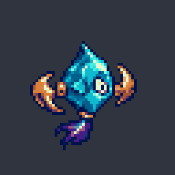
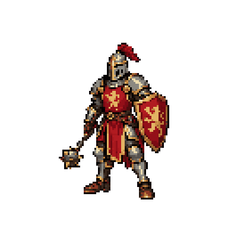
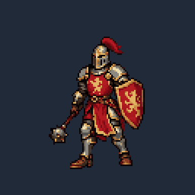
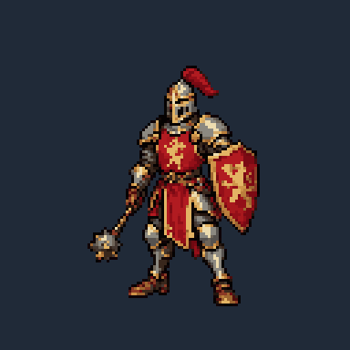
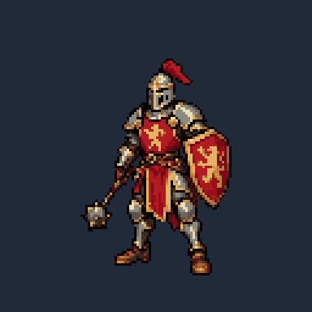

# Pixelwright


헤더: 2048×1024 · 4×4 px 셀 · 32색 · 131,072셀 PASS · [검사 보고서](docs/examples/header/report.json) · [격자 미리보기](docs/examples/header/grid_overlay.png) · [제작 기록](docs/examples/header/)

[English](README.md) · [한국어](README.ko.md) · 버전 0.6.2 · [Apache License 2.0](LICENSE)

**선언한 격자 위에서 정적 PNG 픽셀아트를 만들고, 모든 셀을 검사합니다.**

Pixelwright는 GPT 계열 호스트와 Claude에서 함께 쓰는 AI 스킬입니다. 캐릭터·아이템·UI 아이콘의 일정한 도트 크기, 격자 안에 온전히 들어가는 정사각형 셀, 셀 내부의 정확한 단일 RGBA 색상을 생성하고 검사합니다. 두 생태계에서 동일한 `SKILL.md`와 Python 도구를 사용하며, 실행 호스트에는 파일 접근과 Python 실행 기능이 필요합니다.

팔레트와 논리 픽셀 행렬을 먼저 만든 뒤 정수 배율로 확대하고, 내보낸 PNG를 검사합니다. 이름 있는 색상과 명암 램프를 여러 에셋에서 재사용하거나, 이미 유효한 격자에서 색상을 팔레트에 맞춰 변환할 수 있습니다. 생성형 애니메이션은 선택한 2D 시안을 기준으로 임의 부위의 크기·색·비율·무늬와 시간에 따른 움직임을 검사하며 골격은 필수가 아닙니다. 선언형 리그도 선택적으로 사용할 수 있습니다. 기존 이미지에는 검사 전에 의도한 격자 규격을 선언합니다. 기본 결과에는 원본 이미지와 실제 격자 QA 미리보기를 함께 보여 주어 사용자도 셀을 눈으로 확인할 수 있습니다.

## 같은 기사, 두 가지 격자 규격


Pixelwright 개발 과정에서 실제로 만들고 눈으로 확인한 결과입니다. 풀 플레이트 아머를 착용하고 방패와 플랜지 메이스를 든 전신 기사를 두 규격으로 제작했습니다. 두 PNG 모두 **1024×1536**이며, 동일한 **32색 RGBA 팔레트**(가시 색상 31개 + 투명색 1개)를 사용하고 같은 엄격한 품질 기준을 통과했습니다. 도트 크기를 바꾸면 논리 캔버스와 표현할 수 있는 디테일이 달라지지만, 온전한 정사각형 셀과 정확한 단색 채움은 유지됩니다.

| 버전 | 작화 원본 → 출력 PNG | 도트 1칸 | 단색 셀 | 투명색 포함 색상 수 | 검사 |
| --- | --- | --- | ---: | ---: | --- |
| 세밀한 도트 | [256×384](docs/examples/knight/4px/native.png) → [1024×1536](docs/examples/knight/4px/rendered.png) | 4×4 px | 98,304 / 98,304 | 32 | [PASS 보고서](docs/examples/knight/4px/report.json) |
| 큰 도트 | [128×192](docs/examples/knight/8px/native.png) → [1024×1536](docs/examples/knight/8px/rendered.png) | 8×8 px | 24,576 / 24,576 | 32 | [PASS 보고서](docs/examples/knight/8px/report.json) |

두 검사 모두 **불균일 셀 0개, 반투명 픽셀 0개, 지정 팔레트 밖의 색상 0개**입니다. 투명 셀을 포함해 각 셀 안의 모든 RGBA 값이 정확히 같습니다. 독립적인 픽셀 비교로 출력이 작화 원본을 최근접 이웃 방식으로 정확히 확대한 결과인지도 확인했습니다. [4 px 검증 기록](docs/examples/knight/4px/verification.json) · [8 px 검증 기록](docs/examples/knight/8px/verification.json).

자료 화면에는 원본 이미지와 격자 부분 확대를 함께 배치해 도트 하나하나를 확인할 수 있게 했습니다. 실제 PNG의 도트 크기와 화면 표시용 확대 배율을 각각 표기했습니다. 격자선과 바둑판 배경은 별도 진단 미리보기에만 적용하며, 원본 PNG는 투명 배경과 32색 팔레트를 유지합니다. 이미지 전체를 확인하려면 [4 px 전체 격자](docs/examples/knight/4px/grid_overlay.png) 또는 [8 px 전체 격자](docs/examples/knight/8px/grid_overlay.png)를 열어 봅니다.

생성형 모델의 초기 이미지는 미검증 원본으로 보존하고, Pixelwright의 격자 투영·팔레트 제한 논리 행렬·정수 배율 렌더링으로 검사 대상 결과를 만들었습니다. 이 두 규격의 실제 통과 결과는 도트 크기와 논리 해상도가 달라져도 기술적 품질 기준을 일관되게 충족한다는 근거입니다. 미적 품질은 별도로 눈으로 검수합니다.

[기사 예제 폴더](docs/examples/knight/)에는 편집 가능한 `artwork.json` 행렬, 작화 원본·출력 PNG, 선언한 프로필, 실제 검사 보고서, 독립 검증 기록이 있습니다. 아래 안내에 따라 의존성을 설치한 뒤 동봉한 도구로 두 버전을 재현할 수 있습니다.

```sh
python pixelwright/scripts/pixel_build.py --spec docs/examples/knight/4px/artwork.json --out-dir runs/knight-4px-build-v1
python pixelwright/scripts/pixelwright.py inspect runs/knight-4px-build-v1/rendered.png --profile docs/examples/knight/4px/profile.json --out-dir runs/knight-4px-audit-v1
python pixelwright/scripts/pixel_build.py --spec docs/examples/knight/8px/artwork.json --out-dir runs/knight-8px-build-v1
python pixelwright/scripts/pixelwright.py inspect runs/knight-8px-build-v1/rendered.png --profile docs/examples/knight/8px/profile.json --out-dir runs/knight-8px-audit-v1
```

## 바로 시작하기

**Python 3.12 이상**, Pillow, NumPy가 필요합니다. 저장소 루트에서 실행합니다.

```sh
git clone https://github.com/jungducknam/pixelwright.git
cd pixelwright
python -m venv .venv
```

가상 환경을 활성화합니다.

```sh
# macOS / Linux
source .venv/bin/activate
```

```powershell
# Windows PowerShell
.\.venv\Scripts\Activate.ps1
```

동봉한 랜턴을 만들고 저장된 PNG를 검사합니다.

```sh
python -m pip install -r pixelwright/requirements.txt
python pixelwright/scripts/pixel_build.py --spec pixelwright/examples/lantern.json --out-dir runs/lantern-build-v1
python pixelwright/scripts/pixelwright.py inspect runs/lantern-build-v1/rendered.png --profile pixelwright/examples/item-profile.json --out-dir runs/lantern-audit-v1
```

예제는 16×16 논리 캔버스를 8배 확대해 128×128 PNG를 만듭니다. `rendered.png`, `report.json`, `grid_overlay.png`를 함께 확인합니다. 출력 폴더는 비어 있거나 존재하지 않아야 합니다. 명령을 반복할 때는 새로운 실행 폴더 이름을 사용합니다.

## sprite-gen 시트와 manifest 검증

개발 소스에는 sprite-gen의 완성 PNG와 `manifest.json`을 직접 받는 검사를
추가했습니다. 골격이나 별도의 Pixelwright 스프라이트 명세가 필요하지 않습니다.

```sh
python pixelwright/scripts/pixelwright.py sprite-gen --sheet sprite-sheet-alpha.png --manifest manifest.json --max-colors 32 --out-dir runs/atlas-audit-v1
```

[sprite-gen](https://github.com/aldegad/sprite-gen)의 출력 규격에 의존하는
연동입니다. [패키지 메타데이터](pixelwright/upstream-integrations.json)에
원본 저장소·라이선스·확인한 버전/커밋, `data_format` 관계와
`runtime_required: false`를 기록합니다. CLI와 보고서의 `upstream`에도
표시하며, 호환성 확인 버전을 입력 파일을 생성한 버전으로 단정하지 않습니다.

원래 요청 파일이 있으면 `--max-colors` 대신 `--request sprite-request.json`으로
팔레트 제한을 읽습니다. manifest에 기록된 실제 프레임 좌표를 사용해 공유 팔레트,
안전 여백, 동작별 외곽 크기·보이는 면적의 일관성을 검사합니다. 크기 이상은 자세나
가림 때문일 수 있어 REVIEW로 표시합니다. 원본은 보존하며 JSON 보고서와 프레임
경계·측정값을 표시한 이미지를 출력합니다.

[기사 돌격 예시](docs/examples/mounted-knight-charge-v1/)에서는 실제 62색으로
32색 제한을 넘었고, 8개 중 7프레임이 여백을 위반했으며, 2프레임이 크기 검토
대상으로 잡혔습니다. [실제 보고서](docs/examples/mounted-knight-charge-v1/manifest-audit-v2/report.json)
· [프레임 비교](docs/examples/mounted-knight-charge-v1/manifest-audit-v2/frames.png)
· [입력 형식과 판정 범위](pixelwright/references/external-atlases.md)
· [검증 기록](docs/VALIDATION_external_atlases_ko.md).
도트 격자와 자연스러운 움직임은 각각 별도 검사 대상입니다. 이 소스에서 설치
패키지를 다시 빌드해야 하며, 기존 v0.6.2 배포 파일은 변경하지 않았습니다.

## 팔레트 재사용·추출·색상 변환

버전 0.5.0은 이름 있는 색상과 명암 램프를 담는 재사용 JSON 팔레트 라이브러리를 추가합니다. 작화 명세의 인라인 `palette` 대신 `palette_file`을 지정하면 여러 논리 행렬에서 같은 색상 토큰을 쓸 수 있습니다. [팔레트 예제](pixelwright/examples/palette-demo/)에는 라이브러리를 참조하는 작화와 16×16·8배 프로필이 있습니다.

위의 랜턴 시작 예제를 만든 뒤, 저장소 루트에서 실행합니다.

```sh
python pixelwright/scripts/pixel_palette.py extract runs/lantern-build-v1/rendered.png --max-colors 16 --name lantern-observed --out-dir runs/palette-extract-v1
python pixelwright/scripts/pixel_palette.py ramp --start '#283040' --end '#C8D8E8' --steps 5 --name metal5 --palette pixelwright/examples/palette-demo/palette.json --out-dir runs/palette-ramp-v1
python pixelwright/scripts/pixel_palette.py remap runs/lantern-build-v1/rendered.png --palette pixelwright/examples/palette-demo/palette.json --profile pixelwright/examples/palette-demo/profile.json --out-dir runs/palette-remap-v1
python pixelwright/scripts/pixel_build.py --spec pixelwright/examples/palette-demo/artwork.json --out-dir runs/palette-demo-build-v1
python pixelwright/scripts/pixelwright.py inspect runs/palette-demo-build-v1/rendered.png --profile pixelwright/examples/palette-demo/profile.json --out-dir runs/palette-demo-audit-v1
```

추출은 실제로 관측한 RGBA 색상을 빈도순으로 선택하고 잘린 색상 목록을 알리며, 원본 격자의 PASS를 판정하지 않습니다. 램프 생성은 알파가 같은 양 끝 색상을 서로 다른 명암 단계로 보간합니다. 색상 변환은 선언한 격자와 알파를 유지하고 같은 알파를 가진 가장 가까운 목표 색상을 고릅니다. 기하나 셀 내부 단색 규칙이 잘못된 원본은 변환하지 않습니다. 변환 PNG가 원래 프로필과 선택한 팔레트를 모두 통과할 때만 승인된 `native.png`와 `rendered.png`를 내보냅니다.

`palette_report.json`, 원본·최종 QA, `comparison.png`, 논리 셀 단위 변경 마스크 `changed_cells.png`를 확인합니다. 기술 검사를 통과해도 색상 차이가 합쳐지면서 중요한 디테일을 잃을 수 있습니다. 각 명령은 새 출력 폴더를 사용하고 원본 파일을 보존합니다. 스키마, 선택적 램프 변환, 알파 조건과 출처 해시는 [팔레트 안내](pixelwright/references/palettes.md)에 있습니다.

## 성문을 지키는 기사


**1280×896 PNG · 320×224 논리 셀 · 4×4 px 정사각형 셀 · 32색 · 71,680셀 모두 PASS.** [QA 보고서](docs/examples/castle-guard/report.json) · [전체 정사각형 격자](docs/examples/castle-guard/grid_overlay.png) · [셀 확대](docs/examples/castle-guard/grid-detail.png).

성문·랜턴·멀리 보이는 성·기사를 같은 팔레트와 광원으로 표현했습니다. [편집 가능한 장면 예제](docs/examples/castle-guard/)는 재사용 팔레트 라이브러리를 참조하는 하나의 논리 행렬로 렌더링합니다. 논리 해상도 PNG, 선언한 프로필, 보존한 생성 원본과 독립 검증 자료를 포함합니다. 격자 투영·팔레트 재매핑·논리 셀 단위 워드마크 편집으로 최종 검사본을 만들었으며, 미적 검수는 별도로 기록했습니다.

## 복잡한 요청: 필요할 때 레이어로 작업

복잡한 요청에서는 독립적으로 수정할 수 있는 배경·아이템·UI·문구를 레이어로 나눌 수 있습니다. 캐릭터의 손과 장비처럼 접점이나 포즈가 중요한 요소는 보통 함께 제작합니다. 단순한 아이콘은 하나의 작화로 만들면 됩니다.

먼저 전체 구도, 공통 배율과 RGBA 팔레트, 광원, 앞뒤 순서를 정합니다. `pixel_layers.py`는 JSON 레이어 목록을 관리하고, 모든 입력 PNG를 검사한 뒤 논리 해상도에서 합성하고 한 번 확대해 최종 PNG를 다시 검사합니다. 팔레트는 작품 전체에서 공유합니다. 각 레이어에 별도의 색상 예산을 주면 합성본의 색상 수를 제한할 수 없습니다.

[네 레이어 합성 튜토리얼](pixelwright/examples/layered-scene/)은 배경, 방패·둔기를 함께 든 기사, 아이템, 제목으로 구성됩니다. 320×224 논리 캔버스를 4배 확대해 1280×896 PNG를 만들며, 셀은 4×4 px이고 32개 RGBA 값으로 이루어진 공통 팔레트를 사용합니다. 실제 [레이어별 결과](docs/examples/layered-scene/layers.json), [최종 보고서](docs/examples/layered-scene/final-report.json), [최종 격자 미리보기](docs/examples/layered-scene/grid_overlay.png)를 확인할 수 있습니다.

**네 레이어 모두 PASS, 최종 71,680셀 모두 PASS**입니다. 불균일 셀·반투명 픽셀·공통 팔레트 밖의 샘플은 각각 0개이며, 불투명 최종 PNG에는 가시 RGB 31색을 사용했습니다. 합성 작업을 보여 주는 이 예제는 기존에 검증한 기사와 논리 격자에서 직접 만든 간단한 배경·아이템·문구로 구성했습니다.

```sh
# 레이아웃을 확인한 뒤 모든 레이어와 합성 결과를 검사합니다.
python pixelwright/scripts/pixel_layers.py list --manifest pixelwright/examples/layered-scene/scene.json
python pixelwright/scripts/pixel_layers.py compose --manifest pixelwright/examples/layered-scene/scene.json --out-dir runs/layers-scene-v1

# 제목을 옮기고 원본 옆에 새 레이어 목록을 저장합니다.
python pixelwright/scripts/pixel_layers.py edit --manifest pixelwright/examples/layered-scene/scene.json --layer title --position 16,28 --out pixelwright/examples/layered-scene/scene-title-v2.json
python pixelwright/scripts/pixel_layers.py compose --manifest pixelwright/examples/layered-scene/scene-title-v2.json --out-dir runs/layers-scene-v2
```

`edit`는 `--visible true|false`로 표시 여부를, `--index`로 아래에서 위로 쌓이는 순서의 0부터 시작하는 위치를 바꿀 수 있습니다. 새 목록 파일을 만들며 원본 PNG를 보존합니다. 배치 좌표는 논리 셀 단위 정수이고 레이어 전체가 캔버스 안에 들어와야 합니다. 숨긴 레이어도 검사합니다. 경로는 목록 파일의 폴더를 기준으로 하며 그 폴더 밖을 참조할 수 없습니다.

합성마다 `layers.json`, `layers/0000/qa/` 아래의 레이어별 보고서·격자 미리보기, `final/` 아래의 최종 검사 결과를 만듭니다. **모든 레이어와 최종 PNG가 PASS일 때만** 출력 루트에 승인된 `native.png`와 `rendered.png`를 내보냅니다. 최종 검사에서 실패한 후보는 진단용 `candidate/`에 남기며, 입력 레이어가 실패하면 합성하지 않습니다. 종료 코드는 모두 PASS이면 `0`, QA FAIL/REVIEW이면 `2`, 목록·입력·실행 오류이면 `1`입니다.

이 모드는 레이어의 이진 투명도, 명시적인 공통 팔레트와 가시 RGB 예산, 투명 픽셀까지 정확한 RGBA를 요구합니다. 불투명 셀을 덮어쓰는 방식으로 합성하며 반투명 혼합·크기 변경·회전·잘라내기를 하지 않습니다. 불투명 최종 캔버스 위에 투명 배경의 전경 레이어를 올릴 수 있습니다. 기술 검사 후에는 각 레이어와 완성 장면의 접점·가림·광원·가독성을 눈으로 검수합니다. QA 격자는 작화와 별도 산출물로 유지합니다. 자세한 형식은 [레이어 작업·목록 문서](pixelwright/references/layers.md)에 있습니다.

## 골격 없이 일관적인 2D 애니메이션 생성·검증

새 [`pixel_sequence.py`](pixelwright/scripts/pixel_sequence.py)는 선택한 2D 시안과 물체에 맞게 이름 붙인 부위·특징점을 사용합니다. 실제로 존재하지 않는 물체도 Blender나 사람 관절 이름 없이 다룹니다. 외형·프레임 크기·팔레트·포즈·시간을 고정하고, 같은 시안으로 시트를 생성한 뒤 실제 그림을 독립 관찰해 부위 크기·색·무늬·비율·연결·시간에 따른 움직임을 검사합니다. 특징점의 상대 움직임으로 물체 전체 이동과 부위 자체 움직임을 구분합니다.

이 기능은 `codex/design-first-sprites` / [PR #10](https://github.com/jungducknam/pixelwright/pull/10)의 변경입니다. 이 소스에서 설치 ZIP을 빌드해야 하며 기존에 발행한 v0.6.2 릴리스는 변경하지 않았습니다. 설치 ZIP에 실행 도구·참조 문서·비인간형 튜토리얼이 포함됩니다.

```sh
python pixelwright/scripts/pixel_sequence.py prepare --spec pixelwright/examples/sequence-orbit/spec.json --reference pixelwright/examples/sequence-orbit/reference.png --out-dir runs/orbit-v1
python pixelwright/scripts/pixel_sequence.py import --run runs/orbit-v1 --state orbit --image pixelwright/examples/sequence-orbit/sheet.png --producer authored-tutorial
python pixelwright/examples/sequence-orbit/observe_fixture.py --run runs/orbit-v1 --out runs/orbit-observed.json
python pixelwright/scripts/pixel_sequence.py check --run runs/orbit-v1 --observations runs/orbit-observed.json --out-dir runs/orbit-audit
```

튜토리얼은 직접 작성한 테스트 작화입니다. 별도의 [실제 생성 예제](docs/examples/aetherseed-2d/)는 3D 입력 없이 선택한 2D 시안과 부유 동작 6프레임을 만들었습니다.



파생 PNG의 픽셀 규격은 통과하지만, 관찰한 외형·움직임이 고정 계약을 벗어나 **전체 FAIL·작화 수정 필요**입니다. 미관찰·미검토는 REVIEW로 남깁니다. 부위·특징점은 관찰 입력이며 자동 의미 인식이나 자연스러움을 보증하지 않습니다. [제작 절차](docs/SPRITE_2D_ko.md), [형식 명세](pixelwright/references/sequences.md), [검증 기록](docs/VALIDATION_sequences_ko.md), [요구사항·진행 상황](docs/SPRITE_REQUIREMENTS_AND_STATUS_ko.md)을 참고합니다. 구현은 [#13](https://github.com/jungducknam/pixelwright/issues/13)에서 추적합니다.

## 선택적 3D 경로: 2D 시안 먼저, 골격은 동작에 사용

[애니메이션 제작 경로](docs/SPRITE_3D_ko.md)는 프롬프트나 사용자 참고 이미지로 2D 도트 캐릭터를 먼저 만듭니다. 그 시안의 비율에 맞춰 맨 골격을 3D로 구성한 뒤, 투영된 포즈로 같은 2D 캐릭터를 새로 그립니다. 골격은 카메라·관절·깊이를, 2D 시안은 외형을 결정합니다. Blender 장면에는 갑옷·장비 메시가 없습니다. 소스 체크아웃에서 사용하는 선택적 개발 도구입니다.



| 걷기 | 공격 | 막기 |
| --- | --- | --- |
|  |  |  |

실제 생성 초안은 **128×128 논리 프레임, 공통 24색**입니다. 픽셀 저장 규격과 3D 골격 검사는 PASS지만, 그림을 별도로 관찰한 검사에서는 포즈·장비 크기 실패가 있어 **완성 에셋으로 승인하지 않았습니다**. [예제](docs/examples/knight-design-first/)에 원본 입력, GIF, 실제 격자, 관찰 좌표와 실패 보고서를 보존했습니다. 동작 프레임마다 크기나 중심을 보정하지 않으며, 정상 골격만으로 그림을 통과시키지 않습니다. 이전 [메시 외형 전사 실험](docs/examples/knight-3d/)은 이력으로 남깁니다.

[최신 통합 검증](docs/VALIDATION_design_first_ko.md)에는 Pillow 13 대응, 시안 보호·재생성 원본 보존, 독립 관찰 입력 검사와 실제 예제의 재검사 결과를 기록했습니다.

[요구사항과 진행 상황](docs/SPRITE_REQUIREMENTS_AND_STATUS_ko.md)에 사용자 요구, 구현 상태, 걷기의 접지·체중 이동·반복 연결 결함과 후속 작업을 정리했습니다. 현재 걷기는 자연스러운 보행 품질을 충족하지 못합니다.

## 2D 스프라이트 시트와 골격 검사

README의 기사를 이 스킬로 움직였습니다. 각 애니메이션의 0번 프레임은 헤더의 기사 그림과 같고, 모든 프레임이 원래 32색만 사용하며, 세 시트 모두 엄격한 격자 검사와 리그 검사를 통과했습니다. [기사 리그 제작 기록](docs/examples/knight-animation/)을 참고합니다.

| 메이스 휘두르기 | 방패로 막기 | 걷기 |
| --- | --- | --- |
|  |  |  |

같은 애니메이션에 선언한 골격을 겹치고(왼쪽) 모든 도트를 부위별 색상으로 칠한 모습(오른쪽)입니다.


버전 0.6.0은 여러 프레임 에셋을 위한 `pixel_sprite.py`를 추가합니다. 스프라이트 명세에는 프레임 크기, 여백·간격을 포함한 슬롯 격자, 이름 있는 애니메이션을 선언하며, 프로필의 논리 크기는 이 배치에서 계산한 시트 크기와 같아야 합니다. 검사기는 먼저 시트 전체에 엄격한 격자 검사를 수행한 뒤, 프레임 사이 여백과 빈 슬롯이 투명한지, 선택적 가장자리 여백을 지키는지 확인하고 프레임별 내용 범위를 기록합니다.

움직임을 검사하려면 **리그**를 선언합니다. 이름 있는 관절의 프레임별 좌표와, 보이는 모든 도트를 부위에 배정하는 부위 맵을 함께 기록하며, 부위는 뒤에서 앞 순서로 나열합니다. Pixelwright는 해부 구조를 추정하지 않습니다. 선언한 골격을 모든 프레임 위에 그리고, 각 부위를 그 부위가 가장 잘 보이는 기준 프레임과 비교합니다.

| 움직임 | 대표 부위 | 일관되게 유지해야 하는 것 |
| --- | --- | --- |
| `fixed` | 레버 받침, 상자 본체 | 모든 프레임에서 같은 도트 |
| `rigid` | 머리, 손잡이공, 서랍 | 회전축 관절의 이동량만큼 옮긴 정확한 복사본, 선택적으로 한 축 방향만 이동 |
| `bone` | 팔다리, 몸통, 레버 손잡이 | 뼈대를 따라 옮긴 기준 도트의 위치, 이탈 거리, 도트 수, 뼈 길이 |
| `free` | 망토, 머리카락, 효과 | 존재 여부, 크기, 색상 |

모든 부위는 부모 부위와 맞닿아야 하고, 관절은 해당 부위의 도트 위에 있어야 하며, 고정 관절은 움직이지 않아야 합니다. 프레임 사이 관절 이동 거리에 상한을 둘 수도 있습니다. 도트는 앞에 그려지는 부위가 덮은 칸에서만 사라질 수 있으므로, 팔이 뒤에 그려진 몸통 속으로 사라지는 오류를 잡아냅니다.


[걷기 예제](docs/examples/sprites/)는 8프레임·8부위·관절 9개로 구성되며, 부위·프레임 비교 64건이 모두 PASS입니다. [같은 시트 픽셀을 4번 프레임에서 앞팔이 앞으로 흔들리는 골격으로 검사](docs/examples/sprites/walk-arm-lag/)하면 이 기능이 겨냥하는 실패가 드러납니다. 팔 도트가 뒤에 남아 있어 `PART_OFF_SKELETON`, `PART_DRIFT`, `JOINT_OFF_PART`가 실패합니다. [레버 예제](docs/examples/sprites/)는 고정 받침, 고정 축에 걸린 손잡이, 단단한 손잡이공으로 사물의 움직이는 부분을 다룹니다.

```sh
python pixelwright/scripts/pixel_sprite.py build --spec pixelwright/examples/sprite-walk/spec.json --out-dir runs/walk-build-v1
python pixelwright/scripts/pixel_sprite.py check --spec pixelwright/examples/sprite-walk/spec.json --sheet runs/walk-build-v1/rendered.png --profile pixelwright/examples/sprite-walk/profile.json --out-dir runs/walk-check-v1
```

검사마다 `sprite_report.json`, `sheet/` 아래의 시트 검사 결과, `layout_overlay.png`, `rig_overlay.png`, 그리고 애니메이션별 GIF 미리보기와 골격·부위 색상을 함께 보여 주는 `.rig.gif`를 만듭니다(`--preview-scale`로 크기 지정). 종료 코드는 모두 PASS이면 `0`, FAIL/REVIEW이면 `2`, 명세 오류·실행 오류이면 `1`입니다. 실제로 흔한 실수 11가지를 주입한 시험에서 9가지를 검출했습니다. 한 칸 두꺼워진 팔다리와, 대부분 가려진 얇은 손잡이의 두 칸 이동은 기본 허용치 안에 들었습니다. [스프라이트 참조 문서](pixelwright/references/sprites.md)와 [v0.6.0 검증 기록](docs/VALIDATION_v060_ko.md)을 참고합니다.

## AI 스킬로 사용하기

스크립트·참조 문서·예제를 포함한 **`pixelwright/` 폴더 전체**를 스킬 경로에 넣습니다.

| 호스트 | 개인 설치 | 프로젝트 설치 | 명시적 호출 |
| --- | --- | --- | --- |
| Codex | `~/.agents/skills/pixelwright/` | `<repo>/.agents/skills/pixelwright/` | `$pixelwright` |
| Claude Code | `~/.claude/skills/pixelwright/` | `<repo>/.claude/skills/pixelwright/` | `/pixelwright` |

로컬 설치 경로와 호출 방식은 [OpenAI 공식 스킬 문서](https://learn.chatgpt.com/docs/build-skills), [Claude Code 공식 스킬 문서](https://code.claude.com/docs/en/skills)를 따릅니다. Windows를 포함해 `~`는 사용자 홈 폴더를 뜻합니다.

사용자 스킬 업로드를 지원하는 Claude 환경에서는 아래 명령으로 설치 ZIP을 만든 뒤 호스트의 스킬 화면에서 업로드합니다. 코드 실행과 파일 생성을 활성화하고 Python 의존성이 사용 가능한지 확인합니다. 다른 ChatGPT 환경이나 API 기반 호스트에는 해당 환경의 스킬 로더와 실행 도구가 필요합니다. 시퀀스 생성에는 호스트 이미지 도구 또는 명시적인 Images 호환 HTTP 어댑터를 선택할 수 있으며, 검사와 튜토리얼 실행에는 API 계정이 필요하지 않습니다. [플랫폼 호환성 안내](docs/COMPATIBILITY_ko.md)와 [Claude 공식 사용자 스킬 문서](https://support.claude.com/en/articles/12512180-use-skills-in-claude)를 참고합니다.

스킬을 호출한 뒤 다음과 같이 요청할 수 있습니다.

> 24×24 물약 아이템을 8배 확대해서 만들어 줘. 가시 색상은 최대 10개, 투명도는 이진 값으로 해 줘. 내보낸 PNG를 Pixelwright로 검사하고, 원본과 격자 미리보기를 함께 보여 줘. 실제 PASS/FAIL 보고서도 포함해 줘.

PNG 접근과 검사기의 성공적인 실행이 없으면 결과는 **미검증**입니다. 스킬을 로드하거나 모델에 “픽셀아트”를 요청하는 것만으로 규격 준수를 확인할 수 없습니다. 이 저장소의 검증에서는 실제 Claude 계정 설치·업로드까지 수행하지 않았습니다.

## 품질 규격 선언하기

재사용 가능한 JSON 프로필로 여러 에셋에 동일한 기술 규칙을 적용합니다.

```json
{
  "schema_version": 1,
  "name": "24px game items",
  "logical_size": "24x24",
  "scale": 8,
  "max_colors": 10,
  "alpha": "binary",
  "transparent_rgb": "exact"
}
```

이를 `profile.json`으로 저장합니다. 이 규격은 원점 `(0, 0)`, 8×8 셀, 192×192 PNG를 요구합니다. 가로·세로에 동일한 양의 정수 배율을 적용하며 엄격한 프로필은 배율 2 이상을 요구합니다. 생성·검사 전에 규격을 확정합니다. 검사기는 이미지를 통과시키기 위해 다른 격자를 추정하거나 크기를 바꾸지 않습니다.

`transparent_rgb: "exact"`는 알파가 0인 부분의 숨은 RGB 값도 비교합니다. 숨은 차이를 정규화할 때만 `"visible"`을 명시적으로 선택합니다. 선택 필드 `allowed_palette`로 전체 RGBA 값을 제한할 수 있습니다. `alpha: "any"`는 셀 내부가 균일한 반투명을 허용합니다. 같은 색의 인접 도트가 큰 비정형 모양을 이루어도 됩니다. 정사각형 규칙은 개별 격자 셀에 적용합니다.

모든 필드, 허용 PNG 형식, 산출물, 종료 코드는 [품질 규격 문서](pixelwright/references/quality-contract.md)에 있습니다. 논리 행렬 형식은 [생성 안내](pixelwright/references/creation.md)를 참고합니다.

## 검사·일괄 검사·보정

이미지 하나를 검사하거나 여러 이미지에 같은 프로필을 적용합니다.

```sh
python pixelwright/scripts/pixelwright.py inspect input.png --profile profile.json --out-dir runs/audit-v1
python pixelwright/scripts/pixelwright.py batch item-a.png item-b.png --profile profile.json --out-dir runs/batch-v1
```

프로필 명령은 모두 PASS이면 `0`, FAIL/REVIEW이면 `2`, 입력·실행 오류이면 `1`로 종료합니다. CI의 적합성 판정에도 이 인터페이스를 사용합니다. 미리보기와 함께 JSON 상태, 정확한 위반 개수를 확인합니다.

명시적인 보정은 원본에서 관측한 색상을 선언한 격자에 투영해 새로운 후보를 만듭니다. 이 과정에는 정보 손실이 있을 수 있습니다.

```sh
python pixelwright/scripts/pixel_qa.py fix input.png --logical-size 24x24 --render-size 192x192 --out-dir runs/repair-v1
python pixelwright/scripts/pixelwright.py inspect runs/repair-v1/fixed_upscaled.png --profile profile.json --out-dir runs/repair-audit-v1
```

보정본을 채택하기 전에 `comparison.png`, `fix_review.json`, 원본·보정본 보고서를 확인합니다. 원본 기하는 선언한 격자에 이미 맞아야 합니다. 보정은 원본 파일을 보존하지만 디테일을 제거할 수 있습니다. 보정 파일은 원래 프로필로 다시 검사합니다.

## 검증과 패키징

```sh
python -m unittest discover -s pixelwright/tests -v
python tools/package_skill.py --out-dir dist
python tools/package_skill.py --verify dist/pixelwright-v0.6.2.zip
python tools/verify_release.py --archive dist/pixelwright-v0.6.2.zip --out-dir runs/release-check-v1
```

패키징은 최상위 `pixelwright/` 폴더 하나를 포함하는 설치 ZIP과 테스트·문서를 포함하는 개발 키트 ZIP을 만듭니다. 패키지 검증기는 ZIP 구조와 SHA-256 목록을 검사하고, 릴리스 검증기는 설치 패키지를 풀어 실제로 실행합니다. 빌드 결과는 로컬 `dist/`에 생성합니다.

`verify_release.py`는 패키지 안의 Python 코드를 실행하므로 검토한 Pixelwright 소스에서 만든 신뢰할 수 있는 ZIP에만 사용합니다. 해시 목록이 일치한다는 것은 내부 무결성을 확인할 뿐 배포자의 신원을 증명하지 않습니다.

[v0.6.2 검증 기록](docs/VALIDATION_v062_ko.md)은 655.35초를 넘는 GIF hold와 프레임 경계·실제 저장 시간 보존을 다룹니다. [v0.6.1 기록](docs/VALIDATION_v061_ko.md)은 스프라이트 출력 롤백·부위 연결·가림 회귀, 명시적인 GIF 시간, 유한한 3D 리그 계약과 anchor 정렬을 다룹니다. [v0.6.0 기록](docs/VALIDATION_v060_ko.md)은 최초 스프라이트·애니메이션·부위 리그와 설치 예제를 검증합니다. 이전 기록에는 [정사각형 격자 미리보기](docs/VALIDATION_v051_ko.md), [팔레트](docs/VALIDATION_v050_ko.md), [레이어 합성](docs/VALIDATION_v040_ko.md)을 남겨 둡니다.

## 지원 범위·라이선스·보안

버전 0.6.2는 **정적 PNG 캐릭터·아이템·UI 아이콘, 재사용 팔레트, 선택적 레이어 장면, 골격을 선언한 스프라이트 시트 애니메이션**을 지원합니다. 기술적 PASS는 검사한 파일의 격자, 셀 내부의 정확한 단색, 선언한 프로필 제약을 확인합니다. 색상 변환은 선택한 목표 색상도 확인하며, 팔레트 추출과 램프 생성은 작화의 PASS를 판정하지 않습니다. 레이어 합성은 레이어별 검사와 최종 검사를 모두 통과해야 합니다. 미적 품질이나 다른 앱의 확대 표시 방식까지 보장하지는 않습니다. 실루엣·가독성·팔레트·재질 디테일은 별도로 검수합니다. 리그 검사는 선언한 부위의 도트가 선언한 골격과 일관되는지 확인하며, 해부 구조를 추정하거나 타이밍·무게감·매력을 판정하지 않습니다. 애니메이션 PNG 입력은 계속 지원하지 않습니다.

현재 개발 브랜치는 `pixel_sequence.py`로 선택한 2D 시안의 생성과 독립 관찰에 따른 부위·시간 검사를 추가하며 골격을 필수로 요구하지 않습니다. 작화 품질의 한계는 동일하게 명시하고 생성 원본과 선언한 파생 변환을 구분합니다.

Pixelwright에는 **Apache License 2.0**을 적용합니다. [LICENSE](LICENSE)와 [NOTICE](NOTICE)를 확인합니다.

지원 버전과 취약점 신고 방법은 [SECURITY.md](SECURITY.md)에 있습니다. 저장소에는 [CI](.github/workflows/ci.yml), [CodeQL](.github/workflows/codeql.yml), [의존성 업데이트 설정](.github/dependabot.yml)이 포함됩니다. 이 설정들은 유지 관리를 돕는 장치이며 독립 보안 감사가 완료되었다는 뜻은 아닙니다.

AI 작업 절차는 [`pixelwright/SKILL.md`](pixelwright/SKILL.md), 플랫폼 실행 조건은 [호환성 안내](docs/COMPATIBILITY_ko.md), 구현 판단 근거는 [설계 문서](docs/DESIGN_ko.md)에서 확인할 수 있습니다.
