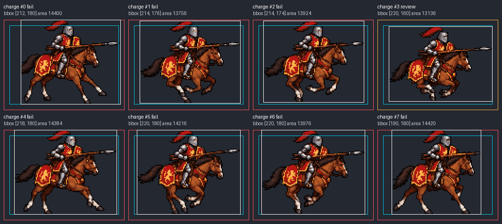

# sprite-gen 시트와 manifest 직접 검사 검증

## 추가한 기능

`pixelwright/scripts/pixelwright.py sprite-gen`은 외부 PNG와 sprite-gen runtime manifest의 `frame_layout`을 읽어 공통 팔레트, 프레임별 안전 여백, 같은 동작 내 크기 일관성을 검사한다. 생성 도구 설치나 별도 Pixelwright sprite spec은 필요 없다. CLI와 Python API는 [사용 문서](../pixelwright/references/external-atlases.md)에 정리했다.

팔레트 제한은 `--max-colors` 또는 원래 요청 JSON의 `fit.palette_size`에서 받는다. 여백은 명시 인자, manifest, 요청 순으로 적용하며 충돌을 REVIEW로 기록한다. 필요한 제한이 없으면 임의로 PASS하지 않는다. 크기는 보이는 외곽 폭·높이와 면적의 동작별 중앙값으로 비교하며, 자세와 잘림의 영향을 구분할 수 없으므로 이상치를 REVIEW로 남긴다.

## 실제 시트

[말 탄 기사 돌격 예제](examples/mounted-knight-charge-v1/README.md)의 변경하지 않은 2048×192 PNG, 8프레임 manifest와 요청 JSON을 검사했다. 재현 명령은 예제 README에 있다.

- 팔레트 FAIL: 32색 제한에 실제 보이는 RGB 62색.
- 여백 FAIL: 12px 기준에 8개 중 7개 프레임 위반.
- 크기 REVIEW: 4번째 프레임 높이 −11.1%, 8번째 폭 −12.0%. 치수 허용폭 10%, 면적 허용폭 25% 적용.
- 배치 PASS: 실제 PNG와 manifest 크기 일치, 겹치는 사각형과 프레임 밖 픽셀 없음.
- [보고서](examples/mounted-knight-charge-v1/manifest-audit-v1/report.json)에 원본 입력 해시와 변경 없음이 기록됐다. [프레임 비교 이미지](examples/mounted-knight-charge-v1/manifest-audit-v1/frames.png)는 모든 프레임을 같은 크기로 표시한다.

동작 내 중앙값은 폭 216px, 높이 180px, 보이는 면적 14,096px이다. 크기 검토 대상으로 잡힌 프레임의 실제 측정은 다음과 같다. 문서 번호는 1부터, JSON의 `frame`과 이미지 라벨은 0부터 시작한다.

| 문서 프레임 | JSON frame | 폭×높이 | 보이는 면적 | 검토 이유 |
| --- | --- | --- | --- | --- |
| 4번째 | 3 | 220×160px | 13,136px | 높이가 중앙값보다 11.1% 작음 |
| 8번째 | 7 | 190×180px | 14,420px | 폭이 중앙값보다 12.0% 작음 |



최종 상태는 FAIL이며 CLI 종료 코드는 2다. 이 결과는 원본을 자동 보정하거나 접지·체중 이동·반복 연결을 인증한 결과가 아니다.

## 구현 검증

2026-10-22, Python 3.12.7 / Pillow 13.0.0 / NumPy 2.5.4 환경에서 확인했다. 커밋 대상 파일을 별도 폴더로 내보내 검증했으며, 기존 보행 실험의 미커밋 변경은 포함하지 않았다.

```sh
python -m unittest discover -s pixelwright/tests -p test_atlas.py -v
python -m unittest discover -s pixelwright/tests -v
python tools/package_skill.py --out-dir .work/atlas-commit-dist-v1
python tools/verify_release.py --archive .work/atlas-commit-dist-v1/pixelwright-v0.6.2.zip --out-dir .work/atlas-commit-release-check-v1
```

- 새 모듈 테스트 23개를 포함해 커밋 대상 전체 테스트 315개 통과.
- 문법 컴파일 통과, 설치용 ZIP과 개발용 ZIP 구조 검증 통과.
- 설치용 ZIP을 풀어 새 CLI를 실행했다. 독립 픽셀 fixture의 정상 입력은 PASS, 변형 입력은 팔레트 FAIL·여백 FAIL·크기 REVIEW·배치 PASS로 구분했다.
- 설치본의 기존 정적 이미지·레이어·팔레트·스프라이트·시퀀스 검증도 통과했다. 입력 파일 보존을 확인했다.
- 분리한 소스로 기사 돌격 시트를 다시 검사해 팔레트·여백·크기·배치 판정, 프레임 측정값과 입력 해시가 저장된 보고서와 일치함을 확인했다.
- 관련 Markdown 6개 파일의 로컬 링크·이미지 대상 185개가 모두 존재한다.

이는 현재 개발 소스에서 다시 만든 ZIP의 검증이다. 기존 공개 v0.6.2 배포 파일은 변경하지 않았다.

## 패키지와 보고서의 upstream 선언

[upstream-integrations.json](../pixelwright/upstream-integrations.json)은 sprite-gen 출력 규격과의 의존 관계를 기계가 읽는 형식으로 선언한다. 설치 ZIP과 개발 ZIP에 포함되며, 검사기는 같은 파일을 읽어 CLI 요약과 `report.upstream`에 넣는다. NOTICE와 사용 문서에서도 출처를 안내한다.

- 원본: `https://github.com/aldegad/sprite-gen`, 라이선스 `Apache-2.0`.
- 관계: `data_format`, 대상 계약 `runtime_manifest.frame_layout`.
- 설치 필요 여부: `runtime_required: false`, 코드 포함 여부 `bundled: false`.
- 호환성 확인 기준: `tested_against.version: 2.45.3`, revision `59b2738a2e76ed7043d9691a230396ed6374a336`.
- 입력 생성기 버전: `producer_version: null`, `producer_version_verified: false`. 입력이 버전을 주장해도 출처 검증 없이 확정하지 않는다.

[출처 선언을 포함한 기사 돌격 보고서](examples/mounted-knight-charge-v1/manifest-audit-v2/report.json)는 같은 시트를 재검사한 결과다. 초기 보고서와 측정값·판정·입력 해시가 같고, upstream 필드가 추가됐다. 기존 보고서는 보존했다.

추가 검증은 새 출처 검사 2개를 포함해 atlas 테스트 25개, 커밋 대상 전체 테스트 317개를 통과했다. 설치 ZIP에서 선언 파일과 보고서의 upstream 값이 일치하고, 임의의 입력 버전을 검증된 출처로 표시하지 않는지 확인했다. 검사 환경에는 `sprite_gen` Python 패키지가 설치되어 있지 않다. 관련 Markdown 로컬 대상 192개가 모두 존재한다.

```sh
python tools/package_skill.py --out-dir .work/atlas-upstream-dist-v1
python tools/verify_release.py --archive .work/atlas-upstream-dist-v1/pixelwright-v0.6.2.zip --out-dir .work/atlas-upstream-release-check-v1
```
