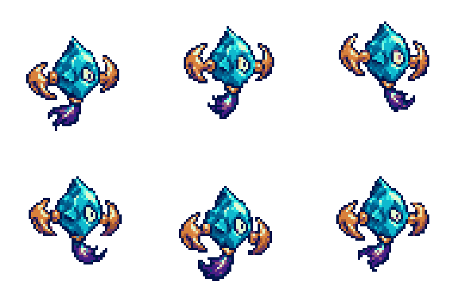
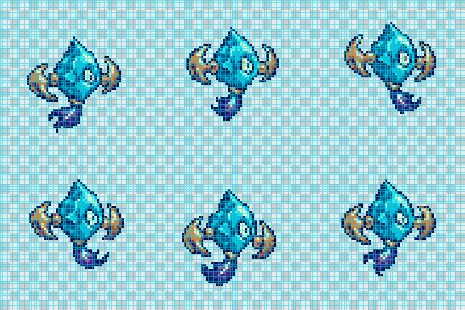
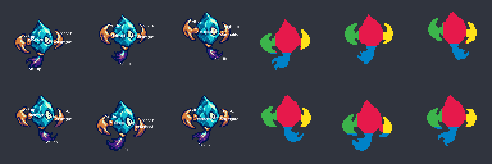

# Aetherseed: real generation without 3D input

2026-10-22. Host `image_gen` made a selected 2D design and a six-frame hover
sheet (two generation calls). No skeleton, mesh, Blender scene or anatomical
rig was supplied. The model identifier is not exposed by the host tool.

The fictional seed has a teal faceted core, cream eye, two copper crescent
vanes and a violet tail. The selected design controls its appearance. The
state call received **only** `run/reference-native.png` and the exact frozen
`run/prompts/hover.txt`. `generation.json` records provenance and hashes.

| Artifact | Result |
| --- | --- |
| Design raw | 1254x1254 RGBA; untouched `design-source.png` and `run/reference-source.png` |
| State raw | 1536x1024 RGBA; untouched `run/raw/hover.png` |
| Frozen contract | 64x64 per frame, 3x2 slots, 24 shared visible colors, 4x output, six 120ms looping poses |
| Derivation | One nearest-neighbor whole-canvas sampling, alpha threshold 128, frozen palette; no per-frame fitting |
| Raw grid | Not certified; compliant exported cells do not certify raw pixel-art fidelity |
| No observations | Overall REVIEW, 0 FAIL / 118 REVIEW / 1 INFO, pixel PASS (`first-audit/report.json`) |
| Assisted observations | Overall FAIL, 65 FAIL / 1 REVIEW / 1 INFO, pixel PASS (`audit/report.json`) |
| Art review | `changes_needed`; no user approval or production acceptance |

The findings include 23 part-color, 24 part-pattern, 8 part-area, 1 measured
proportion, 2 cross-part ratio and 7 timed-speed violations. These are contract
findings, **not 65 independently established visual defects**. Part boundaries
at the connections have about one-cell uncertainty; the manually identified
feature points have up to 1.5-cell snap to actual visible cells. Small shape,
shading and pose changes can affect the simple comparison metrics. The report
keeps those limits separate from the assistant's visual notes.

The eye exceeds the frozen 30 cells/s at 0→1, 3→4, 4→5 and the 5→0 wrap.
The tail tip exceeds 70 cells/s at 1→2 and 3→4; the left vane tip also exceeds
its limit at 0→1. Connection distances pass for the supplied observed points.
The appearance remains recognizable, but facet patterns, vane areas and tail
silhouettes change. The current sheet is a failed draft and was not redrawn or
retimed to hide these findings.








## Reproduce without another generation call

From the repository root, use new outputs:

```sh
python pixelwright/scripts/pixel_sequence.py check --run docs/examples/aetherseed-2d/run --observations docs/examples/aetherseed-2d/observations.json --out-dir runs/aetherseed-recheck
```

Expected exit code: **2**, with the same findings. `observe_example.py` records
the manually selected actual-artwork boundaries and feature points; it measures
visible mask widths/spans and refuses a changed contract or raw-image hash.
It is an assisted observer for this exact example, not a generic semantic part
detector. Its observations were not copied from requested poses or 3D guides:

```sh
python docs/examples/aetherseed-2d/observe_example.py --out runs/aetherseed-observed.json
```

Use the generated coordinate previews to inspect uncertain points and masks.
Any redraw requires fresh observations. Preserve this failed raw image and its
contract rather than editing this run's tolerances.

See [the 2D workflow](../../SPRITE_2D_ko.md) and [validation evidence](../../VALIDATION_sequences_ko.md).
