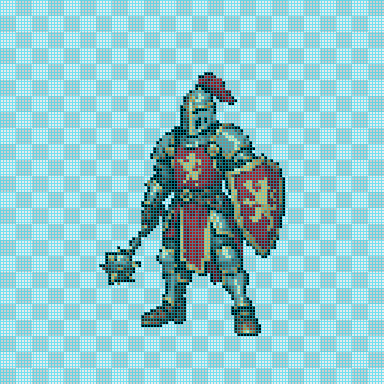
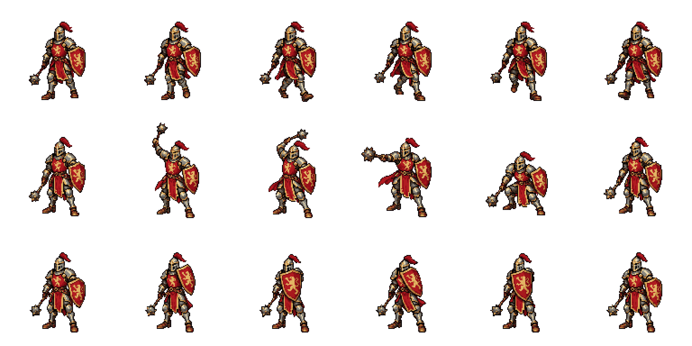
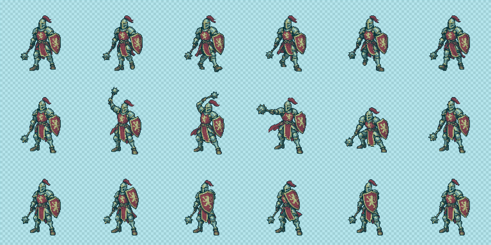
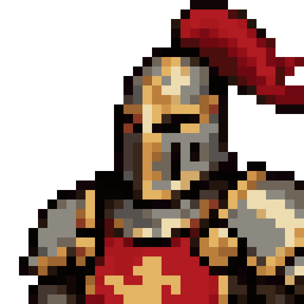
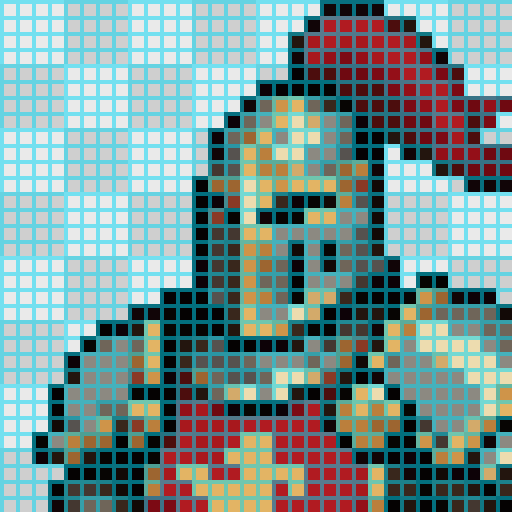
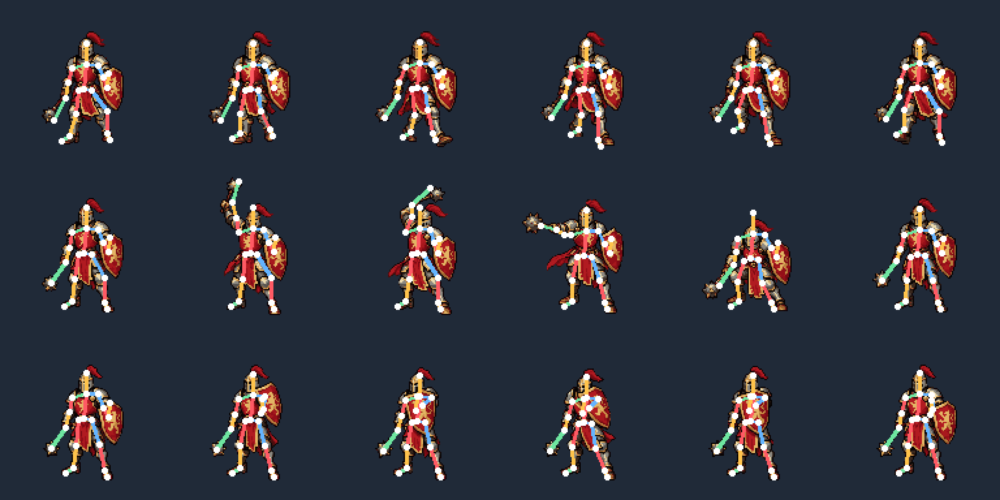
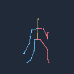
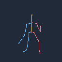
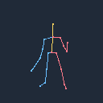

# 2D 시안 → 맨 골격 → 새 2D 애니메이션

골격이나 갑옷 렌더를 보기 전에 생성한 2D 시안입니다. 외형과 신체 비율은 이 시안이 결정합니다.

| 선택된 2D 시안 | 시안 검사기의 실제 격자 |
| --- | --- |
|  |  |

시안 미리보기는 128×128 논리 셀을 3배 확대한 384×384 PNG이며, 정확한 3×3 RGBA 셀 검사 PASS입니다. 아래 애니메이션 원본 시트의 셀은 4×4입니다.

| 걷기 초안 | 공격 초안 | 막기 초안 |
| --- | --- | --- |
|  |  |  |

**완성 에셋으로 승인하지 않았습니다.** 픽셀 저장 규격과 3D 골격은 PASS지만 실제 그림의 포즈·장비 크기는 FAIL/REVIEW입니다. 수동 관찰은 약 1셀 오차가 있으므로 경계 수치는 정밀 검토가 필요합니다. [별도 작화 검토와 수정할 부위](art-review.json)를 확인할 수 있습니다.

2026-10-22 후속 검토에서 사용자가 걷기의 부자연스러움을 지적했습니다. 체중 이동·접지·상체와 장비의 연동·반복 연결을 보완해야 하며, 기존의 개별 포즈 검사는 이 품질을 충분히 검증하지 못합니다. [요구사항·현황과 후속 작업](../../SPRITE_REQUIREMENTS_AND_STATUS_ko.md)에 기록했습니다. [새 2D 도구의 후속 8프레임 실행](../knight-walk-2d/)에서 접지·체중 이동·반복 경계를 재검사했지만 보행은 아직 FAIL입니다. 아래 GIF와 고정 계약은 기존 초안의 이력으로 보존합니다.

| 검사 | 결과 |
| --- | --- |
| 정확한 픽셀 격자 | 128×128 논리 프레임, 4×4 셀, 전체 시트 768×384 → 3072×1536 PASS |
| 공통 팔레트·알파 | 가시 24색, 반투명·잘못된 투명 RGBA 0개 PASS |
| 실제 3D 골격 | 18개 뼈, 18포즈, Blender 외형 메시 0개 PASS |
| 그림 관찰 | 4 PASS / 13 FAIL / 1 REVIEW |
| 작화 검토 | changes_needed, 사람 승인 없음 |





청록 선은 4×4 셀 경계이며, 작화에 포함되지 않는 진단 표시입니다. 아래는 걷기 0번의 같은 32×32 논리 영역을 양 축에 동일한 배율로 확대한 비교입니다.

| 깨끗한 도트 | 실제 검사 격자 |
| --- | --- |
|  |  |



| 골격 걷기 | 골격 공격 | 골격 막기 |
| --- | --- | --- |
|  |  |  |

3D 골격은 [선택된 시안에서 관찰한 관절과 작성한 깊이](generation/design-landmarks.json)로 구성했습니다. 깊이는 2D 한 장에서 자동 복원한 값이 아닙니다. 생성 서비스에는 같은 슬롯 크기의 2D 시안을 첫 입력으로, 선과 점만 있는 맨 골격을 두 번째 입력으로 전달했습니다. 의복 윤곽과 장식은 새로 그리며 3D 메시 실루엣과의 일치를 요구하지 않습니다.

- [Blender 골격](knight-rig.blend), [독립 Blender 검사](rig-check.json), [고정 카메라·포즈 계약](generation/contract.json)
- [실패 포함 보고서](audit/report.json), [독립 그림 관찰](generation/artwork-annotations.json), [픽셀 검사](audit/pixel-check/sheet/report.json)
- [실제 생성 출처·프롬프트·입력 해시](generation.json), [원본 PNG와 고정 입력](generation/), [정수 배율·GIF 시간 검증](verification.json)
- [네이티브 시트](audit/sprite-sheet-native.png), [실행 명세](audit/manifest.json), [공통 팔레트](generation/references/palette.json)

공격 3번은 메이스 머리가 약 10셀에서 14셀로 커지고, 공격 4번은 골격보다 더 깊게 웅크립니다. 막기 1·3·5번은 방패 윗부분이 목표에서 벗어납니다. 가려진 목·골반·투구는 관찰하지 못한 항목으로 남겼습니다. 번호는 0부터 셉니다. 골격 길이가 일정하다는 사실로 실제 그림의 팔다리 길이를 보증하지 않습니다.

선택된 4회와 폐기한 7회를 합쳐 실제 호스트 이미지 생성 11회를 기록했습니다. 모델 이름은 공개되지 않았으며 모의 이미지를 사용하지 않았습니다. 원본은 보존하고, 선택된 결과만 고정 격자와 시안 팔레트에 투영했습니다. 시안 한 장의 사전 균일 등록 외에 동작 프레임별 확대·축소·재배치는 없습니다.

다음 명령은 유료 생성 없이 보존한 입력으로 같은 결과를 재검사합니다. 현재 그림의 실패 때문에 종료 코드 `2`가 정상입니다. 관찰 파일을 생략하면 포즈는 `REVIEW`입니다.

```sh
python tools/knight_design_first.py check --run-dir docs/examples/knight-design-first/generation --annotations docs/examples/knight-design-first/generation/artwork-annotations.json --out-dir runs/design-first-example-check
```

[시안 생성부터 실행하는 절차](../../SPRITE_3D_ko.md)를 참고합니다. GIF는 반복 미리보기이며 공격·막기의 실행 명세는 일회 동작입니다. 이전 [메시 외형 전사 예제](../knight-3d/)는 현재 제작 방식과 다릅니다.
