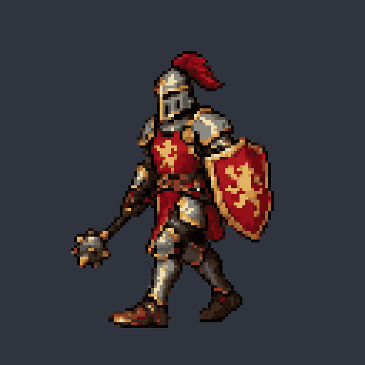
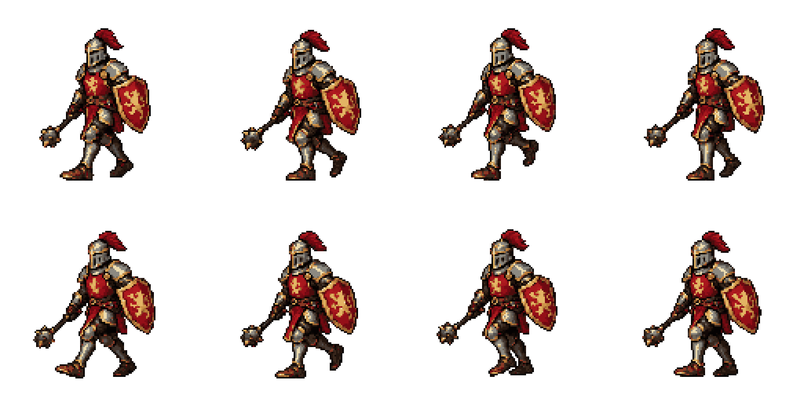
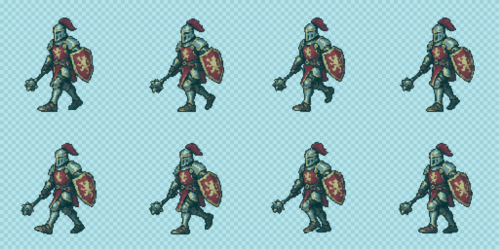
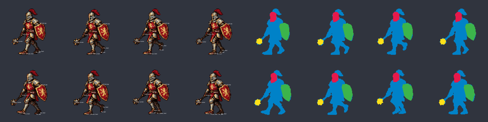

# 새 2D 도구로 다시 생성한 기사 걷기 — 보행 FAIL

2026-10-22. `pixel_sequence.py`의 prepare/import/check를 실제로 실행하고, 기존 선택 기사 시안으로 호스트 **image_gen을 3회 호출**했습니다. 아래는 세 번째 후보입니다. **픽셀 저장 규격은 PASS지만, 접지·체중 이동·지지발 교대와 외형 일관성이 충분히 개선되지 않았으므로 완성 보행으로 승인하지 않았습니다.** 이전보다 자연스러워졌다는 결론도 내리지 않습니다.



GIF는 512×512, 8프레임×110ms, 한 주기 880ms입니다. 검사기가 가독성을 위해 어두운 단색 배경으로 합성한 미리보기이며, 아래 PNG는 투명 알파를 유지합니다. 저장된 GIF를 다시 읽어 모든 시간·반복 설정과 실제 프레임 픽셀을 비교했습니다.

## 실제 결과

| 항목 | 관찰·검사 결과 | 판정 |
| --- | --- | --- |
| 도트 저장 규격 | 논리 프레임 128×128, 정확한 4×4 RGBA 셀, 가시 24색 이내, 이진 알파·투명 RGB 정규화 | 파생 PNG PASS |
| 원본 격자 | 원본 1774×887 → 전체 시트를 한 번만 NEAREST로 512×256에 투영 후 시안 팔레트에 매핑 | 원본 격자 인증 아님 |
| 전체 크기 | 첫 후보의 가시 면적은 시안의 1.70~1.77배로 실패. 세 번째는 사전 고정 0.72~1.30배 범위 | 세 번째 가시 면적 PASS |
| 근거리 발 접지 | 0·1·2번에서 선언된 이동량을 복원한 발바닥 최대 변위 **14.0셀**, 허용 2셀 | FAIL |
| 원거리 발 접지 | 4·5·6번에서 최대 변위 **15.3셀**, 허용 2셀. 일부 접지 높이도 이탈 | FAIL |
| 체중 이동 | 벨트 중심의 상하 변화 **1셀**, 의도한 2~4셀에 미달. 두 번째 하중 수용 4→5번의 하강은 0셀 | 수정 필요 |
| 지지발 교대 | 명목상 반대 착지인 0·4번에서 밝은 앞 정강이가 계속 앞에 남음. 뒤다리가 앞으로 착지하지 못함 | 수정 필요 |
| 반복 경계 | 7→0번의 관찰 특징점 10개 속도, 인접/경계 가속도 제한 이탈 없음 | 수치 제한 PASS, 자연스러운 반복 승인 아님 |
| 외형 일관성 | 투구·방패·메이스의 관찰 치수와 색 무늬 등이 선택 시안에서 이탈 | FAIL |
| 전체 | **기준 이탈 88건 / 검토 17건 / 정보 1건**, 작화 검토 `changes_needed`, 사용자 승인 없음 | **FAIL** |

수치의 단위는 물리 디스플레이 픽셀이 아닌 128×128 논리 셀입니다. 기준 이탈 건수는 프레임·부위마다 반복된 지표도 포함하므로 확정된 작화 결함 수가 아닙니다. 관찰 오차는 약 ±1셀이고, 실제 무게중심이나 질량을 측정한 결과가 아닙니다. 1셀 상하 변화만으로 유의미한 체중 이동을 입증할 수 없습니다.

## 시트·격자·독립 관찰





청록 선은 실제 4×4 셀 경계입니다. 원본을 프레임별로 자르거나 늘리거나 위치를 맞춰 합격시키지 않았습니다. 전체 캔버스의 고정 투영과 팔레트 매핑만 사용했습니다. 따라서 이 PNG의 픽셀 PASS가 생성 원본의 도트 품질이나 보행 자연스러움을 보증하지 않습니다.



[관찰 입력](observed.json)은 생성된 0~7번의 [실제 좌표 미리보기](candidate-3-unobserved/walk/frames/)를 보고 새로 작성했습니다. 관찰상 근거리 다리는 접촉 포즈에서 화면 왼쪽에 보이는 밝은 정강이·부츠, 원거리 다리는 그 뒤의 어두운 다리입니다. 부위 경계를 수동 다각형으로 나누고 실제 알파와 교차했으며, 나머지 가시 픽셀은 캐릭터·자루 부위입니다. 클릭 두 곳만 실제 가시 셀로 1셀 보정했고 [원래 클릭·보정 기록](observation-method.json)에 남겼습니다. 가려지거나 단축된 뒤 정강이 길이는 추정하지 않고 미관찰로 남겼습니다. 기대 포즈나 가이드 좌표를 관찰값으로 복사하지 않았습니다.

## 생성·수정 이력

- [선택된 2D 기사 시안](run-v3/reference-source.png)이 외형 기준입니다. 기존 공격·막기나 이전 3D 기사는 변경하지 않았습니다.
- 1회차: [고정 계약](run/contract.json), [전송한 프롬프트](run/prompts/walk.txt), [원본](run/raw/walk.png), [미관찰 검사](candidate-1-unobserved/report.json). 전체 크기와 다리 교대가 실패했습니다.
- 2회차: [고정 계약](run-v2/contract.json), [전송한 프롬프트](run-v2/prompts/walk.txt), [원본](run-v2/raw/walk.png), [미관찰 검사](candidate-2-unobserved/report.json). 맨 선으로 된 [2D 동작 배치도](pose-constraints.png)를 추가했지만 크기·교대 문제가 남았습니다. 이는 3D 외형 렌더가 아닙니다.
- 3회차: [고정 계약](run-v3/contract.json), [전송한 프롬프트](run-v3/prompts/walk.txt), [원본](run-v3/raw/walk.png). 입력 순서를 **[왼쪽 보행 2D 동작 배치도](pose-constraints-v3.png) → 선택 시안**으로 정하고 지시를 간결하게 작성했습니다. 시안이 바라보는 방향에 맞춰 왼쪽 이동 의도를 생성 전에 선언했습니다.

2·3회차는 각각 새 계약으로 준비했습니다. 자세 설명·이동 방향과 참조 순서를 수정했지만 **면적·색·부위 치수·접지·이동량·속도·가속도·시간의 수락 기준은 완화하지 않았습니다.** [검증 스크립트](verify_example.py)가 세 명세의 기준 동일성을 확인합니다. 세 번째 접지 검사에는 미리 선언한 프레임당 -4셀의 누적 이동만 복원합니다. 실패한 발 좌표에 맞춰 이동량을 다시 추정하지 않습니다.

[생성 출처](generation.json)에 각 호출의 입력 순서·역할·정확한 프롬프트·원본·계약 해시를 기록했습니다. 내장 image_gen을 사용했으며 HTTP 래퍼나 CLI API 경로는 사용하지 않았습니다. 호스트가 모델 이름을 노출하지 않아 임의의 모델명을 쓰지 않았습니다. 3D 입력과 기존 캐릭터 부위 잘라 붙이기는 사용하지 않았습니다.

## 재검사

Python 3.12+, Pillow, NumPy 환경에서 저장된 입력으로 실행합니다. 새 출력 경로를 사용합니다.

```sh
python docs/examples/knight-walk-2d/observe_knight.py
python pixelwright/scripts/pixel_sequence.py check --run docs/examples/knight-walk-2d/run-v3 --observations docs/examples/knight-walk-2d/observed.json --out-dir runs/knight-walk-2d-recheck
python docs/examples/knight-walk-2d/verify_example.py
```

보행 FAIL 때문에 두 번째 명령의 종료 코드 **2가 예상 결과**입니다. 첫 명령은 관찰했던 원본 SHA가 달라지면 중단합니다. 마지막 명령의 실행 성공은 저장된 산출물의 무결성과 알려진 실패를 재현했다는 뜻입니다. 작화 PASS가 아닙니다. [검사 보고서](audit/report.json), [실패 프레임·항목과 재그리기 요청](audit/redraw-requests.json), [GIF·접지·벨트·반복 수치](verification.json)를 참조합니다. 별도로 설치된 같은 도구를 저장소 밖 `/tmp`에서 실행해 전체 보고서가 동일하게 재현되는 것도 확인했습니다. [실행 검증 기록](validation.json)에 환경과 범위를 기록했습니다.

다음 재그리기 대상은 **4~6번의 원거리 발 전진·착지·하중 수용과 7→0번 회수**, 0~2번의 일정한 접지 이동, 두 하중 수용 구간의 골반 하강입니다. 투구·방패를 포함한 모든 프레임의 외형도 선택 시안 치수로 돌아와야 합니다. 프레임 특징점 속도만 제한해서는 이 지지발 교대 결함을 잡을 수 없으므로, 현재 도구는 접지 실패와 작화 검토를 함께 보존합니다.
